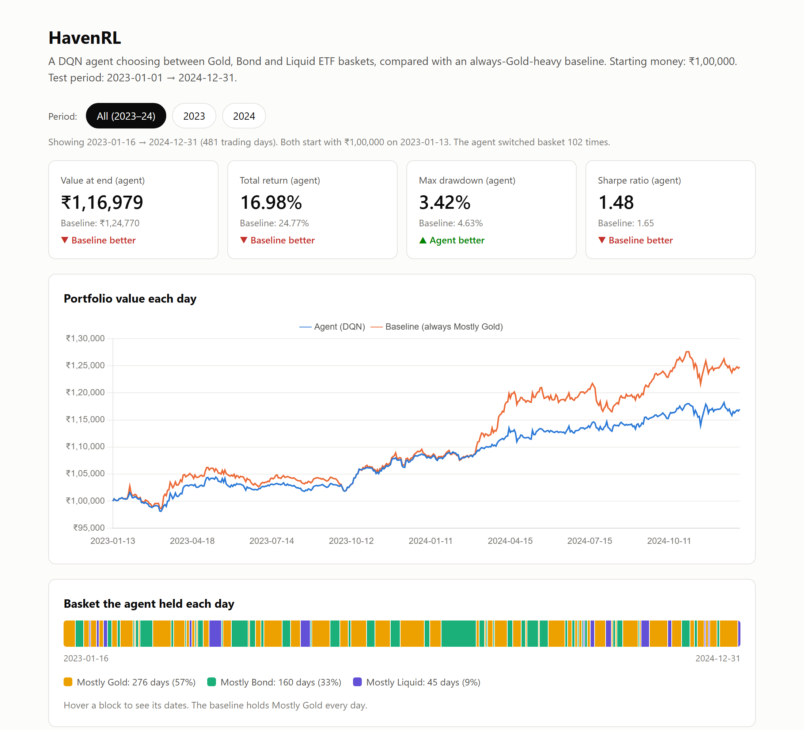
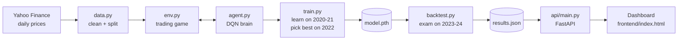

# HavenRL 🛡️

**A reinforcement learning agent that learns to move money between safe-haven assets (Gold, Bonds and Cash-like funds) in the Indian market, then gets tested honestly on two years it has never seen.**



> **The result in one line:** the agent was **safer** (smaller worst fall: 3.42% vs 4.63%) but it **did not beat** a simple "always mostly Gold" strategy on money, mainly because of the big 2024 gold rally.

---

## Contents

- [The idea in plain words](#the-idea-in-plain-words)
- [Results](#results)
- [Insights: what the results really say](#insights-what-the-results-really-say)
- [How it works](#how-it-works)
- [Project structure](#project-structure)
- [Run it yourself](#run-it-yourself)
- [What I tried (experiment log)](#what-i-tried-experiment-log)
- [What you can learn from this repo](#what-you-can-learn-from-this-repo)
- [Limitations](#limitations)

---

## The idea in plain words

You have **₹1,00,000** and three "safe" Indian ETFs:

| ETF | Ticker | Behaves like |
|---|---|---|
| Gold | `GOLDBEES.NS` | grows when markets are scared, but can be bumpy |
| Bharat Bond | `EBBETF0430.NS` | slow and steady interest |
| Liquid | `LIQUIDBEES.NS` | almost like cash, very stable |

Every trading day, the agent picks **one of three baskets**:

| Basket | Gold | Liquid | Bond |
|---|---|---|---|
| 0: Mostly Gold | 60% | 20% | 20% |
| 1: Mostly Bond | 20% | 20% | 60% |
| 2: Mostly Liquid | 20% | 60% | 20% |

It is never told the rules. It **learns by trial and error**: good days give it a reward and bad days a penalty. This is called **reinforcement learning**, and the algorithm used is **DQN (Deep Q-Network)**.

**The opponent (baseline):** a lazy strategy that holds *Mostly Gold* every single day and never changes. If the agent can't beat that, it hasn't learned anything useful.

---

## Results

Tested on **2023–2024**, data the agent **never saw** during training.

| Metric | 🤖 Agent (DQN) | 🟧 Baseline (always Mostly Gold) | Winner |
|---|---|---|---|
| Final value | ₹1,16,979 | ₹1,24,770 | Baseline |
| Total return | 16.98% | 24.77% | Baseline |
| **Max drawdown** (worst fall) | **3.42%** | 4.63% | **Agent** ✅ |
| Sharpe ratio (return per unit of risk) | 1.48 | 1.65 | Baseline |
| Basket switches | 102 | 0 | – |

**Year by year** (each year restarted at ₹1,00,000, using the dashboard's period buttons):

| Year | Agent return | Baseline return | Agent Sharpe | Baseline Sharpe |
|---|---|---|---|---|
| 2023 | 8.52% | 9.13% | **1.68** ✅ | 1.50 |
| 2024 | 7.79% | **14.33%** | 1.31 | **1.78** |

**Quick guide to the metrics:**
- **Total return:** how much the money grew. ₹1,00,000 → ₹1,16,979 is 16.98%.
- **Max drawdown:** the biggest drop from a high point to a later low. A drawdown of 3.42% means you were never more than 3.42% below your best moment. Lower is safer.
- **Sharpe ratio:** growth divided by bumpiness, per year. Two strategies both make 10%: the smoother one has the higher Sharpe. About 1 is good, 2 or more is very good.

---

## Insights: what the results really say

1. **The agent learned to be careful.** Its worst fall was about 26% smaller than the baseline's (3.42% vs 4.63%), and that held in *both* years. It moved into Bonds or Liquid when Gold looked risky.

2. **In a normal year it was the smarter choice.** In 2023 it almost matched the baseline's return (8.52% vs 9.13%) with a **better Sharpe ratio** (1.68 vs 1.50), meaning more return for each unit of risk.

3. **It lost because of one big gold rally.** Gold surged from about March 2024. A strategy that's *always* 60% Gold rides that wave fully. The careful agent spent 43% of days in Bonds or Liquid, so it missed part of it. The chart shows the two lines moving together until early 2024, then splitting.

4. **Being careful has a price.** Lower risk usually means lower return in a strong bull market. The agent took the "safer" trade-off, which is a valid choice, but not one that wins on money when one asset rockets.

5. **Too much trading hurts.** The first version switched baskets 212 times and lost money to fees. Adding a small penalty for switching cut that to 102 and improved the result (see the [experiment log](#what-i-tried-experiment-log)).

6. **An honest baseline matters.** Without the "always Gold" comparison, ₹1,16,979 (+17%) would look great on its own. The baseline shows the real picture.

---

## How it works



### 1. Data: three time periods, like school

| Period | Years | Used for | School version |
|---|---|---|---|
| Train | 2020–2021 | the agent learns here | homework |
| Validation | 2022 | choosing which saved brain to keep | practice exam |
| Test | 2023–2024 | the final score, used **only once** | real exam |

The data is scaled using numbers learned from **train only**. Using later years would be "peeking at the future" (called **data leakage**).

### 2. The trading game (`env.py`)

- **What the agent sees (34 numbers):** the last 10 days of moves for each of the 3 ETFs (30 numbers), plus how its money is currently split between cash, Gold, Liquid and Bond (4 numbers).
- **What it can do:** pick basket 0, 1 or 2.
- **What it gets (reward):** the day's % change in money, after a **0.1% trading fee**, minus a **0.3 penalty** whenever it switches basket. The penalty only affects learning, not the real money. It teaches "only switch when it's really worth it."

### 3. The brain (`agent.py`): DQN

- A small neural network (34 → 128 → 64 → 3) that scores each basket: "how good is picking this, now and in the future?"
- **Replay memory:** stores 10,000 past days and learns from random handfuls of 64, so it doesn't just remember the last few days.
- **Target network:** a slow-moving copy of the brain used for stable learning targets.
- **Explore vs exploit:** it starts by trying random baskets (exploring), and slowly trusts itself more (ε goes from 1.0 to 0.05).

### 4. Training (`train.py`)

100 rounds (episodes) through 2020–2021. After **every** round it sits the 2022 practice exam, and only the brain with the best practice score is saved. This stops it from **overfitting** (memorising the homework instead of learning).

### 5. The exam (`backtest.py`)

The saved brain plays 2023–2024 once, with no learning and no exploring, against the baseline. Everything is written to `artifacts/results.json`.

### 6. API + dashboard

- **FastAPI** (`api/main.py`) is like a waiter: it only *reads* `results.json` and serves it.
  - `GET /`: the dashboard page
  - `GET /summary`: just the headline numbers
  - `GET /results`: everything, including all 482 days
  - `GET /health`: is the server alive?
- **The dashboard** (`frontend/index.html`) is plain HTML + JavaScript + [Chart.js](https://www.chartjs.org/), with no build step. It has:
  - four score cards
  - a value chart you can hover
  - a strip showing which basket the agent held each day
  - **period buttons** (All / 2023 / 2024) that recalculate everything instantly in the browser

---

## Project structure

```
HavenRL/
├── havenrl/              # the core library ("recipe book")
│   ├── data.py           # download prices, split into train/val/test, scale
│   ├── env.py            # the trading game (Gymnasium environment)
│   ├── agent.py          # the DQN agent (PyTorch)
│   └── metrics.py        # total return, max drawdown, Sharpe ratio
├── scripts/              # things you run ("the cook")
│   ├── train.py          # train + pick the best brain on validation
│   └── backtest.py       # final test vs baseline → results.json
├── artifacts/            # saved outputs ("the fridge")
│   ├── model.pth         # the trained brain
│   └── results.json      # the test results
├── api/main.py           # FastAPI server ("the waiter")
├── frontend/index.html   # the dashboard
├── notebooks/            # the original Colab experiment notebook
└── docs/dashboard.png    # screenshot used in this README
```

---

## Run it yourself

**Needs:** Python 3.12+ and [uv](https://docs.astral.sh/uv/) (a fast Python package manager).

```bash
git clone https://github.com/Akash-Dutta07/Haven-RL.git
cd Haven-RL
uv sync                                   # install everything
```

**Just see the dashboard** (uses the saved results, no training needed):

```bash
uv run fastapi dev api/main.py
```
Then open **http://127.0.0.1:8000**. For the interactive API docs, open http://127.0.0.1:8000/docs.

**Train and test from scratch** (run one at a time, about 15–20 minutes on a normal CPU):

```bash
uv run python -m scripts.train      # creates artifacts/model.pth
uv run python -m scripts.backtest   # creates artifacts/results.json
```

<details>
<summary>Using pip instead of uv</summary>

```bash
python -m venv .venv
.venv\Scripts\activate          # Windows  (Mac/Linux: source .venv/bin/activate)
pip install -r requirements.txt
python -m scripts.train
python -m scripts.backtest
fastapi dev api/main.py
```
</details>

---

## What I tried (experiment log)

| Run | What changed | Test result | Switches | Lesson |
|---|---|---|---|---|
| 1 | Basic DQN, no validation | ₹1,05,530 | 212 | **Overfit.** It turned ₹1L into ₹2.5L on training data but did badly on new data. It also traded far too often. |
| 2 | + 2022 validation to pick the best brain, + 0.1 switch penalty | ₹1,10,927 | – | Picking the brain on unseen data helped a lot. |
| 3 ✅ | Switch penalty raised to 0.3 | **₹1,16,979** | 102 | Fewer, better-timed switches. **Final model.** |

After run 3 I **stopped tuning**. Changing settings again and again while looking at the test score would be cheating: the test set would quietly become training data. The final numbers are reported as they came out, even though the baseline wins on return.

---

## What you can learn from this repo

**Reinforcement learning**
- How to turn a real problem into an RL game: **state** (what the agent sees), **action** (what it can do), **reward** (what it's scored on)
- How DQN works in practice: replay memory, target network, ε-greedy exploration
- **Reward shaping:** a small switch penalty changed behaviour from 212 to 102 switches

**Machine learning done honestly**
- A proper **train / validation / test** split for time-series data (no shuffling, no peeking at the future)
- Avoiding **data leakage** (the scaler is fit on train only)
- Using validation for **model selection**, and touching the test set only once
- Always comparing against a **simple baseline**
- Reporting a result honestly even when it isn't a win

**Finance basics**
- Total return, max drawdown and Sharpe ratio, and why return alone isn't enough
- The **risk vs return trade-off**: safer usually means lower return in a strong rally
- Trading costs (0.1% fee) and why over-trading destroys returns

**Software engineering**
- Turning a messy notebook into a clean Python package (`havenrl/`) plus scripts
- Modern dependency management with **uv**
- A small **FastAPI** backend with clear endpoints
- Separating backend and frontend so they only talk through an **API contract**
- A dependency-free dashboard with **Chart.js**

---

## Limitations

- **Only two test years**, and 2024 had an unusual gold rally. Results could look very different in another period.
- **Only three fixed baskets.** The agent can't pick its own exact mix.
- **Simple costs.** A flat 0.1% fee and no taxes, slippage or bid-ask spread.
- **One training seed (42).** RL results can change with the random seed.
- **A backtest, not live trading.** No real money was used, and past performance doesn't predict future results.

> ⚠️ This is a learning project, **not financial advice**.

---

**Built with:** Python · PyTorch · Gymnasium · pandas · yfinance · FastAPI · Chart.js · uv
